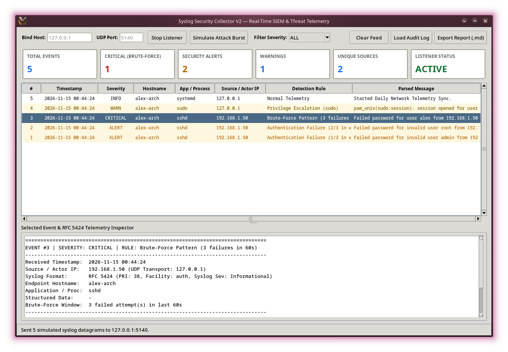

# Syslog Security Collector (V2)

A lightweight Python UDP Syslog server, RFC 5424/3164 parser, and stateful security event collector with both a real-time **Tkinter SIEM GUI** and a **CLI telemetry mode**.

Built as part of an active home lab portfolio on **Arch Linux**, demonstrating endpoint log ingestion, stateful brute-force correlation, and incident reporting for technical sales engineering and security operations.

## Interface Preview

## Architecture & Detection Pipeline

    [ Endpoint / Syslog Client (logger / UDP) ]
                       ↓ (127.0.0.1:5140)
            [ UDP Syslog Listener ]
                       ↓
         [ RFC 5424 / RFC 3164 Parser ]
         (PRI, Facility, Host, App, Msg)
                       ↓
        [ Stateful Detection Engine ]
         ├── Brute-Force Window (3 fails / 60s -> CRITICAL)
         ├── Auth Failures (SSH / PAM -> ALERT)
         ├── Privilege Escalation (sudo -> WARN)
         └── Firewall Drops / System Errors (-> WARN)
                       ↓
       ┌───────────────┴───────────────┐
       ↓                               ↓
    JSONL Audit Log             V2 Desktop GUI
    (security_audit.jsonl)      (KPIs + Treeview + Inspector + .md Export)

## Key Features

- **Real-Time SIEM Dashboard (`collector_app.py`):** Displays 6 live KPI cards (*Total Events*, *Critical Brute-Force*, *Security Alerts*, *Warnings*, *Unique Sources*, *Listener Status*), severity filtering, and a color-coded event feed.
- **RFC 5424 & RFC 3164 Telemetry Decoding:** Extracts Priority (`PRI`), Facility (`auth`, `authpriv`, `daemon`, `user`), Syslog Severity, Endpoint Hostname, Process Name, and Structured Data fields.
- **Stateful Brute-Force Detection:** Tracks failed login attempts per source IP over a sliding 60-second window and automatically escalates repeated failures to `CRITICAL`.
- **Built-In Attack Burst Simulator & Audit Replay:** Includes a one-click **Simulate Attack Burst** generator for live demonstrations, a **Load Audit Log** replay feature, and one-click **Markdown Incident Report** export.
- **Headless CLI Mode (`collector.py`):** Can run independently in a terminal with color-coded console alerts and an end-of-session telemetry summary.

## Getting Started

### Running the Desktop GUI (V2)

    git clone https://github.com/Guapefrt/alex-security-labs.git
    cd alex-security-labs/04-syslog-security-collector
    python collector_app.py

Click **Simulate Attack Burst** in the top toolbar to generate a simulated SSH brute-force sequence and privilege escalation event, or send live system logs from another terminal:

    logger -P 5140 -n 127.0.0.1 -- "Failed password for invalid user admin from 192.168.1.50 port 22"

### Running in CLI Mode

    python collector.py

## Tech Stack & Environment

- **OS:** Arch Linux (Linux Zen Kernel, KDE Plasma)
- **Language:** Python 3 (`tkinter`, `socketserver`, `threading`, `queue`, `json`)
- **Protocols & Standards:** UDP Syslog, RFC 5424, RFC 3164, JSON Lines (`.jsonl`)

## License

This project is available under the [MIT License](LICENSE).
